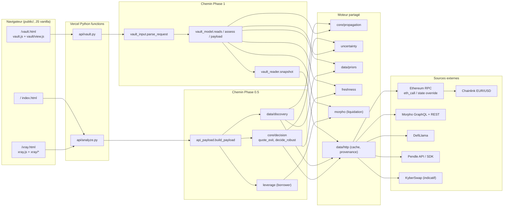
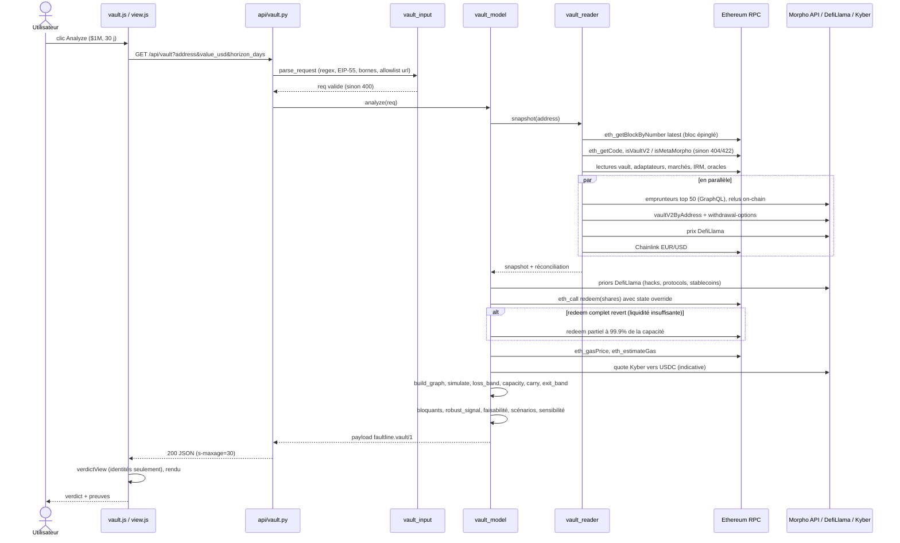

# FAULTLINE — Explication technique complète (du clic au verdict)

> Ce document décrit ce que le code fait **réellement**. Il a été rédigé après lecture des fichiers cités. Il s'appuie aussi sur une exécution live : Belem, $1M, 30 jours, bloc Ethereum 26163312.
>
> Quand un point ne peut pas être établi à partir du code ou d'une exécution, il est marqué **NON ÉTABLI**.
>
> Aucune ligne de code applicatif n'a été modifiée pour produire ce document.
>
> Conventions de notation :
> - `V` : valeur de la position en USD.
> - `H` : horizon en jours.
> - `p` : probabilité de défaillance sur l'horizon.
> - `LGF` : *loss given failure*, la perte si le nœud défaille.
> - `T` : transmission du nœud vers la position.
> - `h = LGF × T` : impact d'un nœud sur la position.

---

## 1. Analyse du dépôt

### 1.1 Stack et points d'entrée

| Élément | Réalité dans le code |
|---|---|
| Langage backend | Python, bibliothèque standard (`http.server`, `urllib`), plus `numpy` pour le Monte Carlo et les tirages. Aucun framework web. |
| Fonctions serverless | `api/analyze.py` (Phase 0.5, position Pendle PT / Morpho) et `api/vault.py` (Phase 1, vault par adresse). Ce sont des classes `handler(BaseHTTPRequestHandler)` au format Vercel Python. |
| Configuration Vercel | `vercel.json` : `includeFiles "{src,data}/**"` et `maxDuration` 60 s. |
| Frontend | Fichiers statiques dans `public/` : HTML et JS vanilla, sans build ni framework. |
| Serveur local | `scripts/dev_server.py` : `ThreadingHTTPServer` qui sert `public/` et route `/api/analyze` et `/api/vault` vers les mêmes handlers. |
| CLI | `src/defirisk/cli.py` : `python -m defirisk.cli auto 1000000` (live) ou `mock`. |

### 1.2 Organisation de `src/defirisk/`

| Module | Lignes | Rôle réel |
|---|---|---|
| `core/models.py` | 45 | Dataclasses `Node`, `Edge`, `DepGraph`. |
| `core/propagation.py` | 66 | `best_paths` (transmission par chemin) et `simulate` (perte attendue exacte + Monte Carlo 20 000 tirages, seed 0). |
| `core/decision.py` | 236 | Coût de sortie Pendle (`quote_exit`, `exit_cost_for`), `decide` (comparaison ponctuelle), `decide_robust` (bandes + carry + fraîcheur), `_gas_usd`. |
| `core/scenarios.py` | 52 | Scénarios Phase 0.5 (depeg, oracle, liquidité, corrélé), appliqués par rôle de nœud. |
| `core/portfolio.py` | 52 | Livre fictif de 10 poches ; seule la poche P0 est touchée par un scénario. |
| `data/discovery.py` | 423 | Découverte Phase 0.5 : choix du marché Pendle / Morpho, construction du graphe PT. |
| `data/sources.py` | 193 | Clients Pendle, Morpho GraphQL, DefiLlama et RPC (`eth_call`, gas, simulation de swap). |
| `data/lineage.py`, `data/registry.json` | 173 | Lignage des tokens sous-jacents (look-through). |
| `data/exposure.py`, `data/peg.py` | 115, 59 | Exposition et historique de peg des stablecoins. |
| `data/priors.py` | 121 | Probabilités de défaillance de base (DefiLlama hacks / protocols), LGF, conversion d'horizon. |
| `data/http.py` | 69 | GET/POST avec cache disque `data/cache` (clé sha256) et suivi de provenance `live` / `cache` / `mixed`. |
| `morpho.py` | 236 | Arithmétique Morpho Blue : LIF, `liquidation_outcome`, état d'un emprunteur, top emprunteurs. |
| `leverage.py` | 100 | Mode `borrower=` de `/api/analyze` (liquidation d'un emprunteur réel). |
| `uncertainty.py` | 218 | `loss_band`, `exit_band`, `carry` (PT), `robust_signal` (règle STAY / EXIT / REVIEW). |
| `freshness.py` | 57 | TTL des entrées décisives et bloquants de fraîcheur. |
| `api_payload.py` | 147 | Assemblage du JSON de `/api/analyze`. |
| `vault_input.py` | 98 | Validation des paramètres de `/api/vault`. |
| `vault_reader.py` | 440 | Lecture on-chain d'un vault Morpho V1 / V2 et de ses marchés, plus les sources secondaires. |
| `vault_model.py` | 779 | Graphe du vault, capacité de retrait, coût de sortie, carry, verdict, scénarios, sensibilité, payload. |
| `keccak.py` | 47 | Keccak-256 en Python pur (sélecteurs et ids de marché Morpho). |
| `decision.py`, `sources.py`, etc. (4 lignes) | – | Shims de compatibilité qui réexportent `core.*` et `data.*`. |

Volume approximatif : 4 500 lignes de Python et 2 000 lignes de JS.

### 1.3 Frontend (`public/`)

| Page | Fichiers | Endpoint |
|---|---|---|
| `/` | `index.html` (script inline), `assets/js/api.js`, `shell.js` | `/api/analyze` |
| `/xray.html` | `xray.js`, `xray/{data,model,graph,chart,util}.js` | `/api/analyze?ref=…` |
| `/vault.html` | `vault.js`, `vault/view.js`, `css/vault.css` | `/api/vault` |
| Données de repli | `data/sample.json` (run réel enregistré), `data/sample-large.json` (**synthétique**) | – |

### 1.4 Données embarquées

| Fichier ou dossier | Contenu |
|---|---|
| `data/cache/` | ≈ 5 000 réponses HTTP mises en cache, utilisées en repli si une source live échoue. Le mode est alors signalé (`cache` ou `mixed`). |
| `data/fixtures/vault_*.json` | 4 snapshots on-chain réels enregistrés par `scripts/record_vault_fixture.py`, pour le replay offline des tests. |
| `data/fixtures/replay_h04.json` | Replay Phase 0.5. |
| `data/mock_graph.json` | Graphe de démo, servi **uniquement** avec `ref=mock` ou en `mock-fallback`, toujours étiqueté comme tel. |

---

## 2. Trace complète : analyse du vault Belem `0xD6d4…48Ec` à $1M

Chemin : `/vault.html` → bouton « Belem » → saisie de $1M → clic sur *Analyze vault*.

1. **`public/assets/js/vault.js` → `buildQuery`**
   - Construit `/api/vault?address=0xD6d4…&value_usd=1000000&horizon_days=30`.
   - Une saisie invalide est refusée côté client et aucun appel n'est fait.
   - Appel `fetch(…, {cache: "no-store"})`.
2. **`api/vault.py` → `handler.do_GET`**
   - Appelle `vault_input.parse_request(query)` :
     - adresse : regex `0x` + 40 caractères hex, checksum EIP-55 si la casse est mixte, adresse nulle refusée ;
     - `chain_id` doit valoir 1 ;
     - `value_usd` dans [1e3, 1e8] (défaut 100 000) ; `horizon_days` dans [1, 365] (défaut 30) ;
     - `shock` contrôlé par regex, `severity` dans [0, 1] ;
     - un paramètre `url` n'est accepté que pour une allowlist d'hôtes (morpho.org, etherscan.io, dune.com) et n'est **jamais fetché**.
   - Appelle ensuite `vault_model.analyze(req)`.
   - Codes de retour :

| Cas | Statut | Cache |
|---|---|---|
| `VaultError` | son propre statut : 404 `not_found`, 422 `unsupported_contract`, 400 `invalid_scenario`, 503 si une source est indisponible | `no-store` |
| `ValueError` | 400 `invalid_input` | `no-store` |
| Autre exception | 500 `internal_error` avec un message générique | `no-store` |
| Succès | 200 | `s-maxage=30` |

3. **`vault_reader.snapshot(address)`** lit l'état on-chain à un bloc épinglé.
   - `eth_getBlockByNumber("latest")` fixe le bloc ; tous les `eth_call` suivants utilisent ce bloc.
   - `detect` :
     - `eth_getCode` vide → 404 ;
     - `VaultV2Factory.isVaultV2(addr)` vrai → version V2 ;
     - sinon `isMetaMorpho` sur les factories v1.0 / v1.1 vrai → version V1 ;
     - sinon 422.
   - Résultat pour Belem : **V2**, détecté par `VaultV2Factory`.
   - `read_vault` lit :
     - `asset`, `name`, `symbol`, `decimals`, `totalAssets`, `totalSupply`, `convertToAssets(1 share)` ;
     - l'idle, soit `asset.balanceOf(vault)` ;
     - les frais (performance et management, convertis du taux par seconde en taux annuel) ;
     - les 4 *gates* ;
     - `liquidityAdapter` et `liquidityData`, décodé en `MarketParams` puis converti en id de marché par keccak ;
     - les `adapters(i)`, avec un typage par adaptateur (`_v2_adapter`) ;
     - `forceDeallocatePenalty`.
   - `read_market`, pour chaque marché, en parallèle sur 6 workers :
     - `idToMarketParams`, `market`, `position(vault)` sur Morpho Blue ;
     - `borrowRateView` de l'IRM, intérêts accrus jusqu'au timestamp du bloc ;
     - `oracle.price()`, décimales et symboles des tokens.
   - `reconcile` vérifie que idle + Σ supply attribuée ≈ `totalAssets`. La couverture vaut 100 % pour Belem.
   - Lancés en parallèle :
     - `borrowers` (Morpho GraphQL, top 50 par marché, revalorisés on-chain) ;
     - `api_vault` (Morpho GraphQL, contre-vérification) ;
     - `api_withdrawal_options` (Morpho REST) ;
     - `asset_price` (DefiLlama ; Chainlink EUR/USD on-chain pour un actif en EUR).
4. **`vault_model.reads(req, snap)`** prépare la décision.
   - Priors DefiLlama : taux de base des hacks, protocole Morpho, historique de depeg des stablecoins.
   - Conversion de $1M en unités d'actif, puis en parts hypothétiques.
   - `simulate_redeem` : `eth_call redeem(shares, 0xdEaD, 0xdEaD)` avec un *state override* qui crédite les parts fictives à `0xdEaD`. **Aucune transaction n'est envoyée.**
   - Si ce redeem complet échoue faute de liquidité, deuxième simulation à 99,9 % de la capacité ordinaire.
   - Gas : `eth_gasPrice` × prix ETH DefiLlama.
   - Quote KyberSwap vers USDC, purement indicative.
5. **`vault_model.assess`** produit le résultat.
   - Construit le graphe (`build_graph`) et calcule les pertes (`propagation.simulate`) et les bandes (`uncertainty.loss_band`).
   - Calcule la capacité de retrait, le coût d'exécution, le carry et `exit_band`.
   - Applique la fraîcheur et les bloquants, puis `uncertainty.robust_signal`.
   - Ajuste selon la faisabilité, calcule les scénarios et la sensibilité.
6. **`vault_model.payload`** sérialise la réponse.
   - Schéma `faultline.vault/1`.
   - Les entiers supérieurs à 2^53 sont émis en chaînes (`_js_safe`).
   - Garde-fou : `0 ≤ EL ≤ V`, sinon `AssertionError`, ce qui renvoie 500.
7. **Frontend (`vault.js`, `vault/view.js`)**
   - Vérifie le schéma et affiche la réponse **sans recalculer aucun chiffre financier**.
   - `verdictView` contrôle seulement les identités (`exit = exec + carry`, `margin = loss − exit`, signe, couleur). Une contradiction s'affiche au lieu d'être masquée.

---

## 3. Backend

### 3.A Sources de données externes

| Source | Appel exact | Utilisé pour | Chemin(s) |
|---|---|---|---|
| Ethereum JSON-RPC (`ETH_RPC_URL`, sinon RPC publics `eth.drpc.org` / blastapi) | `eth_getBlockByNumber`, `eth_getCode`, `eth_call`, `eth_estimateGas`, `eth_gasPrice` | État du vault, des marchés, de l'IRM, des oracles et des emprunteurs ; simulations `redeem` et swap ; gas | vault + analyze |
| Factories Morpho | `VaultV2Factory.isVaultV2`, `MetaMorphoFactory{v1.0,v1.1}.isMetaMorpho` | Détection du type de contrat | vault |
| Morpho Blue (singleton) | `idToMarketParams`, `market`, `position` | Supply, borrow, parts, frais, LLTV | vault + analyze |
| Chainlink EUR/USD (`0xb49f…`) | `latestRoundData` | FX et peg d'un actif en EUR | vault |
| Morpho GraphQL | `vaultV2ByAddress` / `vaultByAddress`, `marketPositions`, `markets` | Contre-vérifications, liste d'emprunteurs (revalorisés on-chain), découverte Phase 0.5 | vault + analyze |
| Morpho REST v0 | `vaults-v2/{chain}:{addr}/withdrawal-options` | Contre-vérification de la capacité de retrait et du force-deallocate | vault |
| DefiLlama coins | `coins/prices/current` | Prix de l'actif, prix ETH pour le gas | vault + analyze |
| DefiLlama protocols / hacks / stablecoins | – | Priors de défaillance et historique de depeg | vault + analyze |
| KyberSwap aggregator | route vers USDC | Coût de conversion USD **indicatif** (hors décision) | vault |
| Pendle API v1/v2 + SDK `convert` | marchés actifs, données, quote de vente du PT | Découverte et coût de sortie PT | analyze |

Le cache disque (`data/http.py`) n'intervient qu'en repli. La provenance (`live` / `cache` / `mixed`) est remontée dans le payload. En vault, une réponse rejouée depuis le cache ajoute un **bloquant** qui interdit tout verdict ferme.

### 3.B Calculs et formules

#### Lecture d'un marché — `vault_reader.read_market`

- Utilisation : `u = borrow / supply`.
- APY d'emprunt : `borrow_apy = expm1(rate_per_s × secondes_par_an)`.
- APY de supply : `supply_apy = borrow_apy × u × (1 − fee_marché)`.
- Facteur d'incitation à la liquidation (LIF, `morpho.py`) : `LIF = min(1.15, 1 / (1 − 0.3 × (1 − LLTV)))`.

#### Capacité de retrait — `vault_model.capacity`

- **V2** :
  - si les gates sont fermées, capacité = 0 ;
  - sinon `ordinary = idle + min(supply du vault, liquidité libre)`, calculé **uniquement** sur le marché `liquidityData` de l'adaptateur de liquidité ;
  - les autres marchés vont dans `force_rows` (force-deallocate, non standard).
- **V1** : `ordinary = idle + Σ_{withdrawQueue} min(supply_m, liquidité_m)`.
- Faisabilité :

| Valeur | Condition |
|---|---|
| `full` | montant ≤ capacité et redeem simulé avec succès |
| `partial` | 0 < capacité < montant |
| `zero` | capacité nulle |
| `unknown` | non déterminable |

#### Coût d'exécution — `assess`

- `friction = A − assets_out(simulation)`. Si seule la simulation partielle a réussi, la friction est mesurée sur celle-ci.
- `exec = friction_USD + gas_USD`.
- Pas de frais de retrait dans VaultV2 / MetaMorpho : `exit_fee_usd = 0`, documenté dans le payload.

#### Carry renoncé (vault) — `assess`

- `carry = V × net × H/365`.
- `net = Σ_m share_m × supply_apy_m × (1 − perf_fee) − mgmt_fee`.
- Taux de référence 0 %. Les récompenses (*rewards*) de l'API sont **exclues** et chiffrées à part dans `rewards_usd_not_counted`.

#### Carry renoncé (Phase 0.5) — `uncertainty.carry`

- `carry = V × (APY implicite PT − APY supply USDC du même marché Morpho) × H/365`.

#### Probabilités — `data/priors.py`

- Conversion d'horizon : `p_H = 1 − (1 − p_annuel)^(H/365)`.
- Taux de base :
  - hacks ≥ $1M sur 3 ans parmi les protocoles de TVL ≥ $10M (cohorte), soit 1,36 %/an au run cité ;
  - borne haute : tous incidents / tous protocoles ≥ $1M, soit 6,91 %/an.
- Modificateurs :

| Critère | Facteur |
|---|---|
| Aucun audit | ×1,5 |
| ≥ 2 audits | ×0,7 |
| TVL ≥ $1B | ×0,5 |
| TVL ≥ $100M | ×0,7 |
| TVL < $10M | ×1,5 |
| Listé depuis moins d'un an | ×1,5 |
| Protocole inconnu | ×1,5 |

- Oracle : `p_oracle = taux × max(part_oracle, 0.05) × 3 × qualité`.
- Stablecoin : épisodes de prix < $0,98 dans l'historique DefiLlama. S'il n'y a aucun épisode, plancher de 0,5 épisode par fenêtre. Sans historique, hypothèse de 10 %/an (cas d'EURCV au run cité).

#### Défaut d'un collatéral — `vault_model.bad_debt_fraction` + `morpho.liquidation_outcome`

- Pour chaque emprunteur, après une baisse `d` du collatéral :
  - liquidé si `v_oracle × LLTV < dette` ;
  - `seized = min(dette × LIF, v_oracle)` et `repaid = seized / LIF` ;
  - `bad debt = dette − repaid`, seulement si tout le collatéral est saisi.
- La dette non indexée (au-delà du top 50) est supposée **au LLTV**, soit le pire cas : `coll = reste / LLTV`.
- Transmission de l'arête `market → collateral` : `bad debt / (supply × d)`, avec `d` = 50 % (`COLLATERAL_SEVERITY`).

#### Défaut d'un oracle — `oracle_drain_fraction`

- `L × max(0, 1 − (1 − d) / LLTV) / supply`, où `L` est la liquidité libre et `d` = 40 % de sur-évaluation.
- Transmission = cette fraction divisée par `d`.

#### Propagation — `core/propagation.py`

- Transmission d'un nœud : somme, plafonnée à 1, des produits de transmission le long des chemins (`path_aggregation = "sum"`).
- Perte attendue centrale (hypothèse d'indépendance) : `EL = V × (1 − Π_i (1 − p_i × LGF_i × T_i))`.
- Contribution d'un nœud : `p_i × h_i × V`.
- Monte Carlo (20 000 tirages, seed 0) : `mc_mean` et `VaR95`.

#### Bandes d'incertitude — `uncertainty.py`

- Classes de paramètres :

| Paramètre | Classe | Bande |
|---|---|---|
| p | stablecoin observé | IC de Poisson de Garwood |
| p | hacks calibrés | ×0,5 à ×(borne haute / central), ou ×3 |
| p | hypothèse | ×0,2 à ×4 |
| p | inconnue | 0 à ×5 |
| LGF | observé | ×0,5 à ×2 |
| LGF | hypothèse | ×0,5 à ×1,5 |
| T | mesurée | inchangée |
| T | non mesurée | ±25 % |

- `loss_band` :
  - `low` = formule d'indépendance aux paramètres bas ;
  - `high` = borne de l'union `min(1, Σ p_i h_i) × V` aux paramètres hauts ;
  - bornes de dépendance aux paramètres centraux : `[V × max p_i h_i, V × min(1, Σ p_i h_i)]`.
- `exit_band` :
  - swap ±25 % sauf s'il est simulé (dans ce cas 0) ;
  - gas ±50 % ;
  - carry ±50 %.

#### Scénarios conditionnels — `vault_model.scenarios`

- `conditional_loss = V × (1 − Π_{nœuds choqués} (1 − sévérité × T))`, avec p = 1.

#### Sensibilité — `vault_model.sensitivity`

- Tornado : p de chaque nœud ×0,5 et ×2, top 6.
- Courbe de crash du plus gros collatéral : baisses de 10 % à 80 %.
- Multiplicateur de break-even : `exit_central / EL_central`.

### 3.C Mesuré vs hypothétique

| Grandeur | Statut |
|---|---|
| Version, actif, totalAssets, parts, frais, gates, adaptateurs, allocations, supply / borrow / LLTV / IRM / oracle des marchés | **Mesuré on-chain** au bloc épinglé |
| Positions des emprunteurs (top 50) | Liste issue de l'API Morpho, **montants relus on-chain** |
| Capacité de retrait ordinaire | **Mesurée** (idle + liquidité libre), contre-vérifiée avec l'API Morpho |
| Produit d'un redeem (`assets_out`), gas units | **Simulé** par `eth_call` avec state override ; aucune transaction |
| Prix de l'actif | DefiLlama (agrégateur off-chain) ; EUR/USD via Chainlink on-chain |
| Carry | APY on-chain, mais **projeté** sur l'horizon : l'APY passé n'est pas une promesse |
| Taux de défaillance p | **Taux de base historiques** (DefiLlama), pas des prévisions |
| LGF, sévérités (50 %, 40 %, 70 %), facteurs ×0,5 / ×3 | **Hypothèses structurelles**, étiquetées dans `assumptions` et `uncertainty` |
| Transmissions `vault → adapter → market` | **Mesurées** (parts d'allocation) |
| Transmissions `market → collateral / oracle` | **Modélisées** à partir des positions réelles et de la mécanique de liquidation |
| Position de $1M | **Hypothétique** : aucune détention n'est revendiquée (`hypothetical: true`) |

---

## 4. Logique de verdict

### 4.1 Règle commune — `uncertainty.robust_signal`

```
EXIT    si loss_low  > exit_high  et aucun bloquant
STAY    si loss_high < exit_low   et aucun bloquant
REVIEW  sinon. lean = comparaison ponctuelle (EL_central vs exit_central) ; confidence = low
margin  = EL_central − (exécution + carry)      (> 0 : rester coûte plus cher)
```

### 4.2 Ajouts propres au vault — `vault_model.assess`

**Bloquants** (ils empêchent tout verdict ferme et forcent REVIEW) :
- prix absent ou de plus de 3 600 s ;
- FX absent ou de plus de 26 h ;
- écart totalAssets API / RPC supérieur à 2 % ;
- adresse d'actif divergente entre API et RPC ;
- écart de prix entre sources supérieur à 1 % ;
- couverture inférieure à 95 % ;
- simulation en échec alors que la capacité couvre le montant ;
- gas non simulé ;
- entrée décisive périmée (`onchain_state` > 120 s, `exit_quote` > 60 s) ;
- replay cache ou offline.

**Avertissements** (ils ne bloquent pas le verdict) :
- APY on-chain vs API au-delà de 50 bp ;
- capacité vs API au-delà de 1 % ;
- liste d'emprunteurs indisponible.

**Faisabilité** :
- un EXIT avec une faisabilité autre que `full` est **rétrogradé en REVIEW**, avec le motif « partial exit, not a 100% EXIT » ;
- un STAY avec une faisabilité partielle reçoit une note informative.

**Couleur et confiance** :
- vert = STAY, rouge = EXIT, ambre = REVIEW ;
- `confidence = low` dès que le verdict est REVIEW.

**Hors décision** : `margin_with_usd_conversion` (quote Kyber) est fourni à titre d'information.

### 4.3 Phase 0.5 — `core/decision.decide_robust`

- Même règle, appliquée aux bandes de `loss_band` et d'`exit_band`.
- Côté sortie : quote Pendle + gas + carry PT.
- Bloquants de fraîcheur : quote de plus de 60 s, état de chaîne de plus de 120 s, replay ou approximation.
- `point_verdict_execution_only` (ancienne règle sans carry) est conservé pour la traçabilité.

### 4.4 Mode emprunteur — `leverage._borrower_decision`

- Compare la perte attendue de l'emprunteur (Monte Carlo passé par l'arithmétique de liquidation) au coût de déleverage (quote Pendle indicative + gas de repay).
- **REVIEW forcé** si la distance à la liquidation est inférieure à 10 %, ou si les intérêts seuls liquident la position dans l'horizon.

---

## 5. Frontend

### 5.1 `/` (`index.html`)

- `FaultLine.loadData()` (`api.js`) appelle `/api/analyze` avec la query string de la page.
- En cas d'échec, repli sur `/data/sample.json`, **étiqueté démo**.
- Affiche le verdict (`verdictBadge`), la source (`sourceBadge` : live / cache / mock), le détail du signal et les barres des principaux facteurs de risque (normalisées pour l'affichage).
- Aucun recalcul financier ; l'animation de comptage est cosmétique.

### 5.2 `/xray.html` (`xray.js`, `xray/*`)

- **Chargement** (`loadPayload`) :
  - `?data=sample|large` charge une fixture (`sample-large.json` est synthétique) ;
  - sinon `/api/analyze?ref=…` avec un timeout de 60 s, et repli sur `sample.json` en cas d'échec.
- **Graphe** : canvas avec mise en page force ou par couches, et raccourcis clavier.
- **What-if côté client** (`xray/model.js`), explicitement présentés comme des simulations :
  - `cascade` ;
  - `positionLosses` : `V(1 − Π(1 − LGF·T))` en supposant une défaillance certaine ;
  - `exitCostOf` : utilise `exit_total_usd` du backend.
- **Verdict** (`decisionView`) :
  - REVIEW s'affiche en ambre avec le *lean* ;
  - les curseurs de break-even recalculent un verdict **what-if** côté client, distinct du verdict du serveur.
- Panneau *look-through* : lignage des sous-jacents.

### 5.3 `/vault.html` (`vault.js`, `vault/view.js`)

- **Chargement** :
  - formulaire adresse / montant / horizon ; bouton Belem ;
  - le deep link `?address=…&value_usd=…&horizon_days=…` lance l'analyse automatiquement ;
  - le schéma `faultline.vault/1` est vérifié à la réception ;
  - en cas d'erreur : message structuré du backend, **aucun chiffre affiché**.
- **Sections** :
  - badges : mode, fraîcheur, couverture, faisabilité de retrait, statut de la quote ;
  - verdict et KPIs ;
  - tableau de décomposition des coûts et explication ;
  - badge de cohérence et avertissements ;
  - allocations ;
  - graphe SVG : colonnes BFS, rayon proportionnel à l'EL, couleur par rôle ; un clic affiche p, LGF et sources ;
  - dépendances partagées ;
  - bande de risque, bornes de dépendance, Monte Carlo et VaR ;
  - principaux facteurs de risque ;
  - scénarios et formulaire de choc personnalisé (relance `/api/vault` avec `shock` et `severity`) ;
  - tornado et courbe de crash ;
  - bloc sortie : capacité, contre-vérification, simulation, force-deallocate, carry ;
  - hypothèses et provenance.
- **Contrôle de cohérence** : `verdictView` contrôle sans recalculer :
  - `exit = exec + carry` et `margin = loss − exit` ;
  - signe de la marge vs verdict ponctuel, et couleur ;
  - un EXIT exige une faisabilité `full`, un REVIEW une confiance `low` ;
  - préfixe de l'explication et bandes.
- **Sécurité** : `esc` neutralise le HTML issu de chaînes on-chain (nom, symbole).

---

## 6. Les trois chemins d'analyse

| | `/api/analyze?ref=auto` | `/api/analyze?borrower=auto` | `/api/vault?address=…` |
|---|---|---|---|
| Objet analysé | Position **non levier** de `value_usd` sur un PT Pendle utilisé comme collatéral Morpho | Même marché, plus le **plus gros emprunteur réel** | Dépôt hypothétique de `value_usd` dans **n'importe quel vault Morpho V1 / V2 Ethereum** |
| Sélection | `discovery._select` : marchés Pendle actifs × marchés Morpho listés à collatéral PT, supply ≥ $1M, triés par supply USD décroissante ; on prend le premier | `morpho.top_borrowers(mid, 1)`, puis relecture on-chain (`borrower_state`) | Adresse fournie, type détecté par les factories |
| Graphe | issuer, underlying, backing, AMM, oracle, feed, lending, Morpho, loan token, chain, plus lignage `registry.json`. Transmissions expertes (0,3 à 0,9) | idem | vault, adapter(s), marchés, collatéraux, oracles, Morpho Blue, chain, actif et FX (neutres). Transmissions **mesurées** ou **modélisées** sur positions réelles |
| Sortie | Quote Pendle SDK (vente du PT) re-exécutée par `eth_call`. Gas = swap + 150 k (`MORPHO_WITHDRAW_GAS`). Repli : approximation `V²/(2L+V)`, étiquetée | Déleverage : quote indicative + gas de repay | `redeem` simulé (state override), capacité de retrait, gas réel |
| Carry | PT implicite − APY USDC du marché | non compté | APY net on-chain du vault, référence 0 % |
| Liquidation | `NOT_APPLICABLE` (`unlevered_exposure`) | HF, distance à la liquidation, grille de prix, dérive des intérêts, vérification d'une liquidation historique | Mécanique de liquidation appliquée **aux emprunteurs des marchés** pour estimer la mauvaise dette subie par le vault |

**Apport de la Phase 0.5** (sur `/api/analyze`) :
- bandes d'incertitude et règle STAY / EXIT / REVIEW ;
- carry sur le côté sortie, utilisé de façon cohérente partout (marge, scénarios, stress, sensibilité, livre) ;
- fraîcheur et bloquants ;
- quote simulée par `eth_call` ;
- mode emprunteur ;
- conventions de signe.

**Apport de la Phase 1** :
- tout le chemin `/api/vault` (`vault_input`, `vault_reader`, `vault_model`, `api/vault.py`) et la page `/vault.html` ;
- le moteur partagé est réutilisé sans changement de comportement par défaut (test `test_v22_engine_default_unchanged`) : `propagation`, `uncertainty`, `priors`, `freshness`, `morpho`, `http`.

---

## 7. Tests, déploiement, limites

### 7.1 Tests présents

| Fichier | Tests (`def test_` / `test(`) | Couverture |
|---|---|---|
| `tests/test_vault.py` | 43 fonctions, ≈ 73 cas paramétrés | V01–V26 : validation des entrées, anti-SSRF, détection, réconciliation, capacité V1 / V2, gates, partial / zero / unknown, absence de double comptage, liquidation, scénarios, bornes et monotonie, EURCV / FX, coût, carry, cohérence des 3 verdicts, bloquants, replay offline |
| `tests/test_vault_live.py` | 7 fonctions (11 cas) | Live : identité on-chain de Belem, 2 autres vaults V2, 1 vault V1, carry, gros montant partiel, erreurs HTTP. Exécutés seulement si `DEFIRISK_LIVE_TESTS=1` |
| `tests/test_compliance.py` | 16 | Exigences du challenge (Phase 0 / 0.5) |
| `tests/test_hardening.py` | 25 | Durcissement Phase 0.5 (fraîcheur, quotes, emprunteur, replay) |
| `tests/test_decision_coherence.py` | 8 | Cohérence STAY / EXIT / REVIEW et signe de la marge (Phase 0.5) |
| `tests/test_lineage.py` | 12 | Lignage et look-through |
| `test_api_payload`, `test_http_cache`, `test_pipeline`, `test_portfolio` | 1 chacun | Fumée |
| `tests/js/vault_view.test.mjs` | 8 | Vues du vault, `buildQuery`, badges, erreurs, layout du graphe, chocs, `esc` |
| `tests/js/decision_view.test.mjs` | 7 | Vue de décision X-Ray |

Résultats de la dernière validation (consignés dans `audit/BELEM_PHASE1_EVIDENCE.json`) :

| Suite | Résultat |
|---|---|
| Offline | 135 passed, 14 skipped (tests live non activés) |
| Live | 149 passed en 177,6 s |
| Node | 17/17 |

**Les tests n'ont pas été relancés pour ce document**, qui ne modifie pas le code.

Les verdicts STAY et EXIT **fermes** sont couverts par des snapshots réels rejoués avec des chocs contrôlés (`test_v19_three_verdicts_coherent`, fixtures `tests/js/fixtures/vault_{stay,exit,review}.json`). **Aucun** vault réel analysé en live n'a produit de STAY ou d'EXIT ferme : les 5 cas live étaient REVIEW / lean STAY.

### 7.2 Déploiement

- Vercel : https://faultline-sandy-three.vercel.app. SHA vérifié lors de la validation Phase 1 : `42dfa00`, commit vide de déclenchement au-dessus de `626191c`.
- Smoke test prod consigné :
  - pages statiques en 200 ;
  - 6 cas d'erreur avec le bon code ;
  - 5 analyses live de vaults ;
  - choc personnalisé ;
  - non-régression Phase 0.5 ;
  - E2E navigateur.
- Le filesystem Vercel est en lecture seule : le cache n'y est pas écrit, seulement lu s'il est embarqué.
- `maxDuration` vaut 60 s. Le run Belem $1M a pris ≈ 11,4 s en local.

### 7.3 Limites

Voir la section 10 et la liste finale ; elles sont regroupées pour éviter les répétitions.

---

## 8. Diagrammes

### 8.1 Architecture



### 8.2 Séquence : clic *Analyze vault* → verdict



---

## 9. Exemple chiffré : Belem $1M, 30 jours (run live, bloc 26163312)

Source : exécution locale live de `vault_model.analyze` avec le payload complet sauvegardé.
- Provenance : `live`, 108 appels live, 0 depuis le cache.
- Durée ≈ 11,4 s ; âge de l'état on-chain à la réponse : 18,9 s ; fraîcheur `fresh`.

Ces chiffres sont **différents** des chiffres prod consignés antérieurement (blocs 26163255–66 : marge −$4 550 à $1M avec un horizon de 90 j). Ce n'est pas une contradiction : le bloc, l'horizon et l'APY ont changé.

### 9.1 Identité

- **Vault** : Belem RWA EURCV (`rwaEURCV`), **Morpho Vault V2**, détecté par `VaultV2Factory`.
- **Actif et prix** :
  - actif **EURCV** à $1,11939 (DefiLlama) ;
  - Chainlink EUR/USD 1,12015, d'où un peg de 0,99932 ;
  - prix de la part 1,0009156 EURCV.
- **Paramètres du vault** :
  - frais de performance 10 %, de management 0 ;
  - gates ouvertes ;
  - 1 adaptateur `MorphoMarketV1AdapterV2` portant 6 marchés ;
  - pénalité de force-deallocate 0.
- **Encours et contre-vérifications** :
  - `totalAssets` = 4 710 606,77 EURCV ($5 273 014) ; idle 0,00345 EURCV ; non attribué 0 ; **couverture 100 %** ;
  - totalAssets API vs RPC : écart relatif 2,7e-7 ; écart de prix 0 ;
  - APY on-chain 2,6132 % vs API 2,6243 %, sous le seuil de 50 bp.

### 9.2 Allocations (mesurées)

| Marché (collatéral/EURCV) | Part du vault | LLTV | Utilisation | Emprunteurs lus |
|---|---|---|---|---|
| mGLOeuro | 85,778 % (4 040 646,7 EURCV) | 77 % | 91,05 % | 2/2 |
| WBTC | 9,671 % | 86 % | 89,1 % | 50 (couverture 0,999997) |
| cbBTC | 2,472 % | 86 % | – | 40 |
| wstETH | 2,080 % | 86 % | – | 39 |
| steakEURCV | ≈ 0 | 91,5 % | – | 2 |
| oTFYe | ≈ 0 | 77 % | – | 1 |

Le vault détient 100 % du marché mGLOeuro, dont la liquidité libre est de 361 743,3 EURCV.

### 9.3 Côté STAY : perte attendue sur 30 jours

| Nœud | p (30 j) | LGF | T (vers la position) | `p × LGF × T × V` |
|---|---|---|---|---|
| Collatéral mGLOeuro | 0,000841 (1,02 %/an : 1,36 % × 1,5 inconnu × 0,5) | 0,5 | 0,52274 = 0,85778 × 0,60941 | **$219,70** |
| Vault (contrats / curateur) | 0,000195 (1,36 % × 0,35 × 0,5 ≈ 0,24 %/an) | 0,7 | 1,0 | **$136,80** |
| Morpho Blue | 0,000195 | 0,7 | 1,0 (somme des parts, plafonnée) | **$136,80** |
| Ethereum | 0,000412 (0,5 %/an, hypothèse) | 0,3 | 1,0 | **$123,57** |
| Oracle mGLOeuro `0x2b43…` | 0,000391 (≈ 0,47 %/an) | 0,4 | 0,04239 | $6,63 |
| Collatéral cbBTC | 0,000841 | 0,5 | 0,01001 | $4,21 |
| Collatéral WBTC | 0,000195 | 0,5 | 0,01301 | $1,27 |
| Oracle WBTC | 0,000391 | 0,4 | 0,00794 | $1,24 |
| Autres (wstETH, oracles cbBTC / wstETH) | – | – | – | $0,74 |
| EURCV (actif), EUR/USD | – | – | 0 (neutres pour la décision) | $0 |

La transmission 0,60941 du marché mGLOeuro vers son collatéral est obtenue ainsi :
- choc de −50 % sur le collatéral et liquidation on-chain des 2 emprunteurs (LIF 1,074) ;
- la mauvaise dette résiduelle vaut 30,47 % de la supply du marché ;
- transmission = 30,47 % / 50 % = 0,60941.

Résultats :
- **EL centrale** (indépendance) = **$630,81**.
- Bornes de dépendance : $219,70 (max) à $630,96 (Σ).
- Bande d'incertitude : **$112,95 à $3 229,07**.
- Monte Carlo : moyenne $798,80 ; **VaR95 = $0**. Les événements sont rares : moins de 5 % des tirages contiennent une défaillance.

### 9.4 Côté EXIT : coût réel de sortie

**Taille et capacité** :
- $1M / $1,11939 = **893 342,29 EURCV**, soit 892 525 090 839 633 581 960 740 parts brutes hypothétiques.
- Capacité ordinaire (V2, marché de liquidité uniquement) = idle 0,0035 + min(4 040 646,7 ; 361 743,3) = **361 743,30 EURCV = $404 932,47**.
- L'API Morpho `withdrawal-options` donne la même valeur (écart relatif 2,7e-17).

**Simulations** :
- `redeem` complet simulé : **revert « insufficient liquidity »** ; `maxRedeem` vaut 0 par conception sur V2 et n'est pas utilisé comme limite.
- `redeem` partiel simulé à 99,9 % de la capacité (361 381,557 EURCV) : `assets_out` égal à la demande, donc **friction 0**.
- Gas : 389 054 unités × 0,066 gwei × ETH $2 505 = **$0,0639**.
- Statut de la quote : `simulated_partial`.

**Faisabilité** : **partial**. $404 932 retirables immédiatement ; **531 598,99 EURCV = $595 067,53 bloqués ou différés**.
- Ce montant bloqué **n'est pas compté comme une perte** : c'est une contrainte d'exécution.
- Il interdit cependant un EXIT ferme : la règle de rétrogradation de la section 4.2 s'applique.
- La voie force-deallocate (669 959 EURCV ≈ $749 947, pénalité 0) est **affichée mais non utilisée** : elle est non standard et non simulée.

**Carry renoncé** :
- `net` = 2,9036 % × (1 − 10 %) = **2,6132 %**.
- Carry = 1 000 000 × 2,6132 % × 30/365 = **$2 147,85**, bande ±50 % : $1 073,93 à $3 221,78.

**Côté sortie total** :
- 0,0639 + 2 147,85 = **$2 147,92**, bande $1 073,96 à $3 221,88.
- Conversion USD via Kyber (indicative, hors décision) : $430,37 sur $404,9k.

### 9.5 Verdict

| Élément | Valeur |
|---|---|
| Marge = EL − sortie | 630,81 − 2 147,92 = **−$1 517,10**. Négative : rester coûte moins cher en central |
| Verdict ponctuel | **STAY** |
| Recouvrement des bandes | perte [113 ; 3 229] vs sortie [1 074 ; 3 222] : **oui** |
| Verdict | **REVIEW**, ambre, confiance low, *lean* « STAY holds if true risk < ×3.40 central » |
| Ce qu'il faudrait pour un STAY ferme | `loss_high` < $1 074 |
| Ce qu'il faudrait pour un EXIT ferme | `loss_low` > $3 222 **et** faisabilité `full` (impossible aujourd'hui à $1M) |
| Bloquants | aucun |
| Avertissements | aucun |
| Marge avec conversion USD (information) | −$1 947,47 |

**Sensibilité** :
- Tornado : mGLOeuro $521–$850 ; vault et Morpho $562–$768 ; chain $569–$754.
- Break-even ×3,405.

### 9.6 Scénarios (pertes conditionnelles, p = 1)

| Scénario | Perte | Retirable après |
|---|---|---|
| mGLOeuro −40 % | $157 447,69 (avec le risque de fond : $157 794) | $404,9k |
| Oracle mGLOeuro +40 % | $16 954,37 | – |
| Défaillance du marché mGLOeuro (70 %) | $600 443,39 | – |
| Crise de liquidité | $0 de perte directe (avec le risque de fond : $622,39) | **$0,0039** (idle seulement) |
| Corrélé (collatéraux émis −40 %, oracle, liquidité 0) | $160 377,67 | $0,0039 |
| Depeg EURCV −10 % | $100 000 | **neutre** : rester et sortir en EURCV perdent autant |

Courbe de crash de mGLOeuro :

| Baisse | 10 % | 20 % | 30 % | 40 % | 50 % | 60 % | 80 % |
|---|---|---|---|---|---|---|---|
| Perte | $0 | $0 | $53 525 | $157 448 | $261 370 | $365 293 | $573 138 |

Jusqu'à −20 %, les liquidations couvrent entièrement la dette.

### 9.7 Lecture pour un gérant

> En coût attendu, rester est moins cher : environ $631 de risque contre $2 148 de rendement renoncé. Mais les incertitudes se recouvrent, d'où REVIEW. Une sortie complète est de toute façon impossible aujourd'hui : seuls ≈ 40 % de la position sont retirables immédiatement. Le risque est concentré sur **un seul collatéral** (mGLOeuro, 86 % du vault). Une chute de 40 % de ce collatéral coûterait environ $157k et bloquerait la sortie.

---

## 10. Évaluation objective

### 10.1 Ce qui est solide (vérifié dans le code et à l'exécution)

- **Découverte réelle et automatique** à partir d'une simple adresse :
  - type du contrat (factories) ;
  - adaptateurs, marchés, collatéraux, oracles et emprunteurs ;
  - lus on-chain à un **bloc épinglé**, avec réconciliation à 100 % et contre-vérifications API.
- **Coût de sortie mesuré, pas supposé** :
  - simulation `redeem` par `eth_call` avec state override ;
  - capacité de retrait réelle, contre-vérifiée ;
  - distinction explicite entre la partie retirable et la partie bloquée.
- **Mécanique de perte défendable** : la mauvaise dette provient des positions réelles des emprunteurs passées dans l'arithmétique de liquidation Morpho Blue. Ce n'est pas un coefficient arbitraire.
- **Décision honnête sur l'incertitude** : bandes, bloquants, rétrogradation d'un EXIT partiel, confiance `low` pour REVIEW. Le frontend contrôle les identités et ne recalcule rien.
- **Transparence** : chaque nœud porte sa source, sa classe (mesuré / calibré / hypothèse) et sa justification. La provenance live / cache est explicite, et le mock est toujours étiqueté.

### 10.2 Ce qui reste fragile ou non établi

- **Probabilités** : ce sont des taux de base de cohorte, ajustés par des facteurs fixes. Elles ne sont pas spécifiques au curateur, à l'émetteur RWA ou à l'oracle. La qualité d'un oracle de vault n'est **pas évaluée individuellement** (×1,0).
- **Hypothèses structurelles** : LGF, sévérités (50 / 40 / 70 %), facteur ×0,5 pour le vault et Morpho, chain 0,5 %/an, EURCV 10 %/an faute d'historique. Elles déterminent l'ordre de grandeur de l'EL, et la bande ×0,2 à ×4 le reflète.
- **Agrégation** : indépendance au centre ; la somme des chemins plafonnée à 1 peut surpondérer des nœuds atteints par plusieurs chemins.
- **Emprunteurs** : top 50 par marché via l'API. Le reste est supposé au LLTV, ce qui est conservateur mais **non mesuré**.
- **Capacité de retrait** : partagée avec les autres déposants et variable à chaque bloc. Le force-deallocate n'est **pas simulé**.
- **Carry** : référence 0 %, APY courant projeté sur l'horizon, bande arbitraire de ±50 %, récompenses exclues.
- **Verdicts fermes** : en live, seuls des REVIEW (lean STAY) ont été observés. STAY et EXIT fermes ne sont démontrés que sur des snapshots rejoués avec chocs.
- **Périmètre** : Ethereum, vaults Morpho V1 / V2. Les adaptateurs de type inconnu sont signalés et leurs actifs restent non attribués. Le chemin vault ne traite pas Pendle.
- **Infrastructure** : RPC publics par défaut (latence, limites de débit), limite Vercel de 60 s, prix de l'actif off-chain (DefiLlama).
- **VaR95 = $0** : non informative pour des événements rares. Ce sont la bande et les scénarios qui portent l'information de queue.
- **Quote Kyber** : indicative et non simulée, donc exclue de la décision.
- **What-if X-Ray** : les curseurs recalculent un verdict côté client. Il est présenté comme un what-if, pas comme le verdict serveur.

### 10.3 Correspondance avec les critères du jury (constat, pas promesse)

| Critère | Constat |
|---|---|
| Dependency discovery (30 %) | Profondeur jusqu'à vault → adapter → market → collateral / oracle → Morpho Blue / chain, sur données on-chain. Lignage RWA au-delà du token de collatéral : **non fait** dans le chemin vault. |
| Impact estimation (30 %) | Mauvaise dette issue de positions réelles + EL / bandes / scénarios en USD. Dépend fortement des priors et des LGF supposés. |
| Decision usefulness (25 %) | STAY / EXIT / REVIEW avec marge, break-even, faisabilité de retrait réelle et raisons. Les REVIEW dominent en pratique. |
| Working demo (15 %) | Déployé, testé en prod sur 4 vaults réels (5 cas). Tests offline, live et Node verts lors de la dernière validation. |
