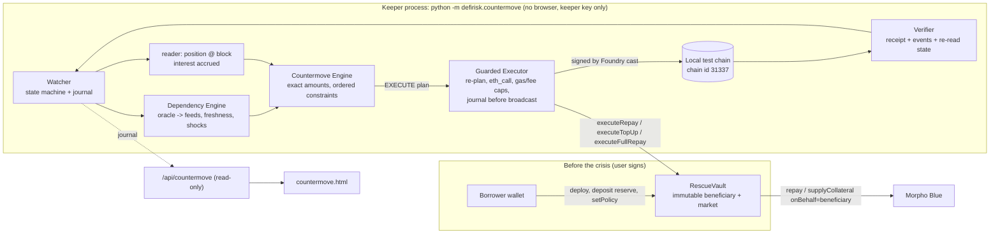

# FAULTLINE — Phase 2 Implementation Report: Autonomous Countermove

> Status: **prototype validated on a test environment** (local Anvil fork of Ethereum mainnet). This is not an
> authorization to manage real funds. No transaction was sent to Ethereum mainnet; no personal or production key was used.
> Reference specification: `docs/FAULTLINE_Countermove_v3_Autonomous_Crisis_Response.md`.
> Progress log: `docs/FAULTLINE_PHASE2_PROGRESS.md` · Security: `docs/FAULTLINE_PHASE2_SECURITY_REPORT.md` ·
> Demo: `docs/FAULTLINE_PHASE2_DEMO_GUIDE.md` · Evidence: `audit/FAULTLINE_PHASE2_EVIDENCE.json`.

## 1. What was delivered

**DETECT → UNDERSTAND → SIMULATE → CHOOSE → EXECUTE → VERIFY**, end to end, for Morpho Blue **borrowers**:

1. **P0 fixes for vault depositors** (Phase 1 path, kept separate): the VaultV2 `forceDeallocate` exit route is now
   simulated and used; partial exits are compared on one economic basis.
2. **RescueVault** (Solidity 0.8.26): a pre-funded, narrowly permissioned reserve that can only `repay` or
   `supplyCollateral` on Morpho Blue on behalf of one fixed beneficiary, inside owner-set limits checked on-chain.
3. **Countermove keeper** (Python, `src/defirisk/countermove/`): Watcher, Dependency Engine, Countermove Engine,
   Guarded Executor, Verifier, with a journal and restart recovery. Runs as an OS process, without any browser.
4. **Reproducible fork demonstration** on real Morpho Blue markets (weETH/USDC, cbBTC/USDC) with controlled, labelled
   shocks: AUTO-REPAY, AUTO-TOP-UP, NO ACTION, and EMERGENCY FULL REPAY, each confirmed and verified on-chain (or, for NO
   ACTION, proven not to have sent anything).
5. **Frontend** `public/countermove.html` (+ `/api/countermove`): before / during / after the crisis, LIVE / SIMULATED /
   CONFIRMED / FAILED / NO ACTION labels, proof-checked confirmations, LIVE mainnet dependency reads, a policy draft that
   the user signs with their own wallet.

## 2. Architecture

| Function (mission §3) | Module | What it does |
|---|---|---|
| Watcher | `watcher.py`, `reader.py`, `journal.py` | One cycle per position per tick at one pinned block; `WATCHING → DETECTED → PLANNING → VALIDATING → EXECUTING → CONFIRMED / FAILED / NO_ACTION`; append-only JSONL journal + crash-safe `state.json` (pending action written before broadcast) |
| Dependency Engine | `dependencies.py` | Reads the market oracle's immutable feeds (`BASE_FEED_1/2`, `QUOTE_FEED_1/2`, vaults, `SCALE_FACTOR`), each feed's description / decimals / answer / update time; freshness vs block time; implicit assumptions (e.g. "USDC valued as exactly 1 USD", "weETH valued at its protocol exchange rate"); maps a shock on a named dependency to an exact oracle price factor; attributes a move to the feed that moved |
| Countermove Engine | `engine.py` | Exact minimal repay / top-up / full repay with Morpho integer math and interest projection; ordered constraints; deterministic ranking; NO_ACTION with reasons |
| Guarded Executor | `executor.py`, `signer.py`, `chain.py` | Local-chain guard; fresh re-plan; `eth_call` of the exact calldata from the keeper; gas / fee caps; keeper gas funds; signing by Foundry `cast mktx` from an encrypted keystore (no key on any command line; chain id 31337 only); journal before broadcast; ambiguity resolved from the chain only |
| Verifier | `verifier.py` | Receipt status, vault `RescueExecuted` event (action id, strategy, amount), Morpho `Repay` / `SupplyCollateral` event for the beneficiary, re-read position at the receipt block, exact reserve movement, counters, LTV and buffer improvement, LTV ≤ keeper bound, no Morpho position held by the vault |

Re-used rather than duplicated: Morpho integer math (`morpho.py`: `max_borrow`, `to_assets_up`, `accrue`,
`w_taylor_compounded`, `liquidation_incentive_factor`, `liquidation_outcome`), `keccak.py`, and the new shared `abi.py`
(also used by the P0-A multicall simulation).

## 3. P0 corrections (vault depositors, Phase 1 path)

### P0-A — withdrawal capacity of VaultV2 (`vault_reader.py`, `vault_model.py`)

**Defect.** Only the ordinary route (idle + liquidity-adapter market) was counted. For Belem $1M the product said
"partial: $405k now, $595k blocked" although the permissionless `forceDeallocate` route made the full exit executable.

**Fix.**
- `capacity()` classifies every non-liquidity market as a forceDeallocate row: `simulable` for Morpho market adapters
  (`data = abi.encode(MarketParams)`), `theoretical` otherwise; penalty read on-chain (raw WAD kept).
- `force_plan()` covers the shortfall × (1 + 0.1%), cheapest penalty first then deepest free liquidity, never more than
  99.9% of a market's free liquidity; penalty = `mulDivUp(assets, penalty, WAD)` exactly as `VaultV2.forceDeallocate`.
- `simulate_force_exit()` runs `eth_call VaultV2.multicall([forceDeallocate(adapter, data, assets, 0xdEaD)…,
  redeem(shares, 0xdEaD, 0xdEaD)])` from `0xdEaD` whose share balance is set by a state override (multicall
  delegatecalls itself, so the penalty is charged to 0xdEaD's own shares), plus `eth_estimateGas`. Read-only.
- Feasibility: `full` (ordinary route simulated) · `full_via_force_deallocate` (multicall simulated for the full amount)
  · `partial` (largest simulated tranche) · `zero` · `unknown`. **A route counts as executable only if its simulation
  succeeded**; computed-but-unsimulated capacity is listed under `routes.unconfirmed`. A full redeem that simulates above
  the computed capacity is now `full` (it was `partial`).
- Execution cost of the force route = gas + friction where friction includes the penalty (paid in shares). Crash
  scenarios report the force capacity as confirmed (simulated at the pinned block, liquidity unchanged) or theoretical.

**Live evidence (read-only `eth_call`, block 26,164,187 and recorded fixture at 26,164,196):** Belem $1M →
`full_via_force_deallocate`; ordinary capacity 361,743.30 EURCV ($404,925); plan = WBTC market 455,098.43 + cbBTC market
77,049.44 EURCV; multicall `status ok`, **647,212 gas**, **penalty 0**; $1,000,000 withdrawable now, $0 blocked. The audit
had measured 647,152 gas with an independent script. Decision unchanged: REVIEW, lean STAY (EL $632 vs exit side
$2,150: rendement abandonné > perte attendue). Re-assessed LIVE by the evidence collector at block 26,164,685: same
feasibility, $1M withdrawable now, 647,224 gas, penalty 0.

### P0-B — one economic basis for partial exits (`vault_model.assess`)

**Defect.** A partial exit compared the total expected loss with the execution cost of the tranche plus the total carry.

**Fix.** `w` = simulated tranche / position (1 for full routes). The decision compares, on `comparison_basis`:
loss avoided `EL × w` (band × w) vs execution of that tranche + forgone carry `carry × w`; the residual `EL × (1 − w)`
is reported as still exposed. No total term is mixed into a partial comparison; the sensitivity break-even uses the same
basis. With no executable route (zero / unknown) the full position is compared hypothetically and never yields EXIT.
The UI view-model checks the identity (`expected_loss = position_expected_loss × fraction`) and flags a mixed basis.

**Regression tests:** `tests/test_vault_p0.py` (18): ABI vectors vs `cast`, market-params preimage, route
classification, plan bounds, Belem $1M replay, firm EXIT only via a simulated route, reverted / unsimulated force routes,
penalty as cost, partial force route, scenario force capacity, partial terms × w (w ≈ 0.4), the old high-friction bias
to EXIT removed, full-position basis unchanged, w ∈ {0, 0.4, 1}, UI fixtures in sync. Plus the live test
`test_live_belem_1m_force_deallocate_route` and 4 Node tests. `test_live_belem_large_position_partial` asserted the old
under-estimate ("not full ⇒ blocked > 0") and was corrected to the new semantics.

## 4. RescueVault (`contracts/src/RescueVault.sol`)

Solidity 0.8.26, optimizer 200 runs, OpenZeppelin v5.6.1 (`SafeERC20`, `ReentrancyGuard`), Morpho Blue v1.0.0
interfaces/libraries (`MarketParamsLib`, `SharesMathLib`, `MathLib`). One vault = one owner, one beneficiary, one market.

| Item | How it is enforced |
|---|---|
| Beneficiary, Morpho, market (loan, collateral, oracle, IRM, LLTV) | `immutable`; constructor checks the market exists and matches `idToMarketParams` |
| Strategies | bitmask `REPAY=1`, `TOP_UP=2`, `FULL_REPAY=4` in the owner policy |
| Per-action caps | `maxRepayPerAction`, `maxTopUpPerAction`, `maxFullRepay` (0 = disabled) |
| Cumulative caps | `maxRepayTotal` (partial + full), `maxTopUpTotal`; counters reset only by a new owner policy |
| Reserve floors | `minLoanReserve`, `minCollateralReserve` must remain after an action |
| Validity / cadence | `validUntil`, `cooldown`; no policy (nonce 0) = expired |
| Trigger | the keeper may act only if the **on-chain** LTV (Morpho debt accrued in the same tx via `accrueInterest`, market oracle) ≥ `triggerLtv` (< LLTV) |
| No over-spending | partial actions must strictly lower the LTV, stay ≥ `minLtvAfter` (owner floor) and ≤ `maxLtvAfter` (keeper's own plan bound) |
| Parameter-change protection | `expectedPolicyNonce` must equal `policyNonce` (bumped by every `setPolicy`) |
| Replay / repetition | `actionUsed[actionId]` (marked before external calls, rolled back on revert), cooldown, trigger re-check |
| Token behaviour | `SafeERC20`, `forceApprove` then reset to 0, exact balance delta on the vault AND on Morpho (fee-on-transfer / rebasing revert), Morpho's returned `assets`/`shares` checked |
| Reentrancy | `nonReentrant` on every state-changing external entry point that moves tokens |
| Pause / revoke | `setPaused`; `revoke()` is irreversible (keeper = 0, paused) |
| Recovery | `withdrawReserve(token, amount)` sends **only to the owner**, any time, even revoked |

The keeper has **no** function to transfer tokens, choose a recipient, borrow, withdraw collateral, change the
beneficiary / policy / keeper, or execute calldata: those code paths do not exist (no fallback, no receive).

## 5. Countermove engine — decision math (`engine.py`)

Units: raw integers; oracle scale 1e36; WAD for LTVs and factors. Morpho's exact health check:
`maxBorrow(C, P) = wMulDown(mulDivDown(C, P, 1e36), LLTV)`, liquidatable iff `maxBorrow < debt`.

- Scenario prices `P_s = P × f_s / WAD` (rounded down). `f_s` comes from the Dependency Engine: a fall `d` of a base feed
  gives `× (1 − d)`, of a quote feed `÷ (1 − d)`. The current price is always a scenario.
- Debt projection over the reaction horizon `h` with the on-chain rate: `D_h = D + mulDivUp(D, wTaylorCompounded(r, h), WAD)`.
- Buffer `B_s = maxBorrow(C', P_s) − D'_h`; target: `B_s ≥ m` for every scenario.
- **Minimal repay** `r*`: per scenario, the largest `x` with `project(x) ≤ maxBorrow(C, P_s) − m` (exact binary search);
  `r* = max_s (D − x) + 2 wei` (share rounding). If any scenario needs `x < 0`, only closing the debt can meet the target.
- **Minimal top-up** `q*`: per scenario, the smallest `C'` with `maxBorrow(C', P_s) ≥ D_h + m` (estimate + exact binary
  search); `q* = max_s (C' − C)`. The added collateral takes the same scenario price (same token, same oracle path).
- **Full repay**: the accrued debt; the keeper bound is `debt × (1 + 0.1%)` for interest until inclusion.
- Verified: minimal **to the wei / raw unit** (`r* − 1` and `q* − 1` fail) on 4 parameter sets incl. 6/8/18 decimals; the
  spec's worked example gives exactly **460 USDC** repay vs **594.32 USDC** of top-up value.

**Comparator** (mission §7 order): 1 security & permissions (global gates: no policy / paused / revoked / wrong keeper /
expired / cooldown / no debt / on-chain trigger not met; per action: strategy authorized, per-action and cumulative caps,
reserve floor, LTV floor) → 2 feasibility (tokens actually in the reserve, partial repay < debt, collateral has a price)
→ 3 buffer ≥ m in every scenario → 4 rank survivors by **reserve value committed** (repay `r`; top-up `q × P`, both in
loan-token units at the current oracle price), tie-break by the configurable preference order (or `ranking=preference`).
Nothing eligible → `NO_ACTION` with every candidate's first reason; a bounded partial mitigation only if the owner set
`allow_partial`. A scenario breach below the on-chain trigger is an **ALERT**, never a transaction.

**Why repay usually wins when funded:** one repaid unit raises every buffer by 1; one unit of collateral value raises it
by `LLTV × f_s` only (0.86 × 0.92 = 0.79 in the demo), so a top-up needs ≈ 1.26× more reserve value for the same target.
TOP_UP is chosen when the loan-token route is infeasible (S2) or preferred by the owner.

**Quantities never merged:** `principal_repaid` (debt reduced 1:1, not a loss), `collateral_added` and
`exposure_added_value` (still the user's asset, adds exposure), gas (the only cost lost), and the hypothetical liquidation
penalty under the worst scenario (labelled hypothetical, never summed).

## 6. Fork demonstration (mainnet block 26,164,248, Anvil chain id 31337)

Real: Morpho Blue `0xBBBB…EFFCb`, weETH/USDC `0x85252bb8…8ba16e` (oracle = weETH/ETH exchange rate × ETH/USD),
cbBTC/USDC `0x64d65c9a…3fcc64` (oracle = Chainlink BTC/USD) and PT-reUSD-10DEC2026/USDC `0x1e9d6146…a4fc64` (LLTV 91.5%;
MorphoChainlinkOracleV2 `0x217d…51f0` whose only feed is the "Ojo PT Feed Pendle Chainlink-compatible Oracle"
`0x77ee…5d89`, computed at read time), IRMs, liquidity. Simulated and labelled: test balances
written into storage; the crises (the shocked feed's code is replaced by `ShockFeed`, `description()` = "FAULTLINE
SIMULATED SHOCK"). S1–S4: positions opened at 75% LTV (LLTV 86%); a −9% move brings them to 82.42% (trigger 82%);
engine target: buffer ≥ 250 USDC after a further −8% move of the market's main feed, interest over 24 h.
S5 (the Belem brief's own example, layer 3 "incident"): a Pendle PT used as collateral, incident on the oracle pricing the
PT. Position opened at 85% LTV; the PT feed −5% brings it to 89.47% (trigger 88%, LLTV 91.5%); target: buffer ≥ 250 USDC
after a further −5% of the PT feed, interest over 24 h (the follow-on puts the target, LLTV × 0.95 ≈ 86.9%, below the trigger).

| | Position (user) | Reserve & policy | Engine decision | On-chain result (fork) |
|---|---|---|---|---|
| **S1 AUTO-REPAY** | 10 weETH / 20,838.10 USDC (A) | 5,000 USDC + 0.05 weETH | REPAY **1,086.50 USDC**; TOP_UP needs 0.5432 weETH > 0.05 (feasibility); FULL needs 20,838 > 5,000 | tx `0x4b9254eb…87e2` block 26,164,285, 306,222 gas; debt 20,838.10 → **19,751.60**; LTV 82.42% → **78.12%**; buffer 905.76 → **1,992.26 USDC**; 15/15 checks |
| **S2 AUTO-TOP-UP** | 0.5 cbBTC / 31,117.34 USDC (B) | 100 USDC + 0.2 cbBTC; full repay disabled | TOP_UP **0.02509364 cbBTC**; REPAY needs 1,499.01 USDC > 100 (feasibility) | tx `0x7ccb73cc…9050` block 26,164,287, 279,145 gas; collateral 0.5 → **0.52509364**; borrow shares unchanged; LTV 82.42% → **78.48%**; buffer 1,352.56 → **2,982.14 USDC**; 14/14 checks |
| **S3 NO ACTION** | 4 weETH / 8,335.24 USDC (C) | 150 USDC + 0.01 weETH; full repay disabled | NO_ACTION: REPAY needs 584.58 > 150; TOP_UP needs 0.2923 > 0.01; FULL cap 0 | **no transaction**; reserves 150 USDC / 0.01 weETH untouched; alert repeated on the post-crisis pass |
| **S4 EMERGENCY FULL REPAY** | 0.3 cbBTC / 18,670.41 USDC (D) | 21,000 USDC; policy = full close only | FULL_REPAY **18,670.41 USDC** (REPAY / TOP_UP not authorized) | tx `0xeea9ca52…aee5` block 26,164,288, 276,851 gas; debt **0**; collateral 0.3 kept; reserve 21,000 → 2,329.59 USDC; 12/12 checks |
| **S5 PT ORACLE INCIDENT → AUTO-REPAY** | 50,000 PT-reUSD / 41,726.94 USDC (E) | 3,000 USDC + 5,000 PT; REPAY or TOP_UP allowed, full repay not | **Both** partial defenses meet every constraint: REPAY **1,447.44 USDC** (rank 1) vs TOP_UP 1,785.66 PT = 1,665.52 USDC of value (rank 2, and it would add exposure to the very oracle in incident); FULL_REPAY not authorized | tx `0xbc1651a0…9ba8` block 26,164,299, 277,657 gas; debt 41,726.94 → **40,279.50**; collateral unchanged; LTV 89.47% → **86.37%**; buffer 944.99 → **2,392.43 USDC**; reserve 3,000 → 1,552.56 USDC; 15/15 checks |

All four rescue transactions were signed by the keeper `0x7099…79C8` (Anvil test account #1) in a separate process
(`python -m defirisk.countermove`, key used from an encrypted keystore created for the run); the users' nonces are
identical before and after the crisis (no user signature).
The same dependency crisis gave different outcomes for different pre-authorizations (S1 vs S3, S2 vs S4). S5 is the only
scenario where two defenses qualify: the comparator's rule (least reserve value committed) picks the repay.
S5's user arms after phase B (still before the PT incident), so S1–S4 run on exactly the same blocks as without S5.
The run is reproducible: `scripts/countermove_fork_demo.py` re-creates everything from the pinned block. The recorded run
(`data/countermove/demo/latest/`, 102 s, after the signer moved to an encrypted keystore) reproduced the S1, S2 and S4
transaction hashes of the previous run byte for byte (same key, same deterministic signatures); amounts can otherwise
differ between runs only by seconds of accrued interest.
Observed edge (S5, post-crisis pass): after the rescue the follow-on buffer is 249.99988 USDC, 0.00012 USDC under the
250 USDC margin, because one block of interest (8% APR on 40k USDC) accrued between the validation block and inclusion.
The LTV (86.37%) is below the 88% trigger, so the keeper only re-alerts (ALERT, nothing sent) and the vault would refuse
any action. The engine's minimal amount does not budget the inclusion delay; S1–S4 happened to keep a few raw units of slack.
Full hashes, blocks and checks: `data/countermove/demo/latest/summary.json` and the evidence JSON.

## 7. Frontend

`public/countermove.html`, `assets/js/countermove.js`, `assets/js/countermove/view.js`, `assets/css/countermove.css`,
nav link in `shell.js`. Data: `GET /api/countermove` (`api/countermove.py` → `countermove/api.py`), which computes every
human figure (token units, LTVs, buffers, remaining limits, reserve what-if with the same engine). The view-model only
formats and **refuses to show CONFIRMED** without a 32-byte tx hash, `verified = true` and all checks passing (downgraded
to FAILED); it flags payloads contradicting the action (repay that did not reduce debt, user signature during the crisis…).

- Before: position, oracle dependencies + freshness + assumptions, the signed policy, reserves funded, reserve what-if.
- During: LTV at detection vs trigger, the dependency that moved (SIMULATED badge), scenarios, actions compared with
  stage and reason, the chosen action and why, pre-send validation checks.
- After: action, amount, tx hash, signer, gas, debt / collateral / LTV / buffer / reserve before → after, verification
  checks, protections still active, limits remaining. Keeper runs and commands; LIVE mainnet dependency panel
  (`?live=1`, read-only); policy draft validated with the contract's rules → calldata for the user's own wallet.

## 8. Files

**Created** — `src/defirisk/abi.py`; `src/defirisk/countermove/` (`__init__`, `__main__`, `api`, `chain`, `contracts`,
`dependencies`, `devchain`, `engine`, `executor`, `journal`, `reader`, `signer`, `verifier`, `watcher`);
`contracts/` (`foundry.toml`, `install_deps.ps1`, `src/RescueVault.sol`, `src/sim/ShockFeed.sol`, `src/sim/LocalSim.sol`,
`test/RescueVault.t.sol`, `test/RescueVaultTokens.t.sol`, `test/RescueVaultInvariant.t.sol`, `test/RescueVaultFork.t.sol`,
`test/helpers/MorphoArtifacts.sol`, `test/helpers/WeirdTokens.sol`); `api/countermove.py`;
`scripts/countermove_fork_demo.py`, `scripts/collect_phase2_evidence.py`; `public/countermove.html`,
`public/assets/js/countermove.js`, `public/assets/js/countermove/view.js`, `public/assets/css/countermove.css`;
`tests/test_vault_p0.py`, `tests/test_countermove_engine.py`, `tests/test_countermove_e2e.py`,
`tests/test_countermove_api.py`, `tests/js/countermove_view.test.mjs`, `tests/js/fixtures/{countermove,vault_force,
vault_partial}.json`; `data/fixtures/vault_0xd6d4…48ec_1m.json`; `data/countermove/demo/latest/*`;
`docs/FAULTLINE_PHASE2_{IMPLEMENTATION_REPORT,SECURITY_REPORT,DEMO_GUIDE,PROGRESS}.md`; `audit/FAULTLINE_PHASE2_EVIDENCE.json`,
`audit/FAULTLINE_PHASE2_SLITHER.txt`.

**Modified** — `src/defirisk/vault_model.py`, `src/defirisk/vault_reader.py`; `public/assets/js/vault.js`,
`public/assets/js/vault/view.js`, `public/assets/js/shell.js`, `public/assets/css/theme.css`; `scripts/dev_server.py`,
`scripts/record_vault_fixture.py`; `tests/test_vault_live.py`, `tests/js/vault_view.test.mjs`,
`tests/js/fixtures/vault_{exit,review,stay}.json` (re-exported with the new fields); `.gitignore`; `README.md`; `docs/README.md`.

## 9. Tests executed

Exact counts and commands are recorded in `audit/FAULTLINE_PHASE2_EVIDENCE.json` (`tests`), produced by
`scripts/collect_phase2_evidence.py --live --fork` from the final runs.

| Suite | Scope | Final result |
|---|---|---|
| `pytest` offline | Phase 0.5 + Phase 1 (unchanged, still green), P0 regressions (18), engine (32), API (7 + 1 live-gated), end-to-end keeper on a local Anvil with the real Morpho Blue bytecode (17, incl. the keystore signer) | **209 passed**, 16 skipped (live-gated), 0 failed |
| `pytest` live (`DEFIRISK_LIVE_TESTS=1`) | files with live checks: Phase 0.5/1 live checks, Belem $1M forceDeallocate route, LIVE oracle dependencies | **134 passed**, 0 failed |
| Node | vault view (incl. P0), X-Ray decision view, Countermove view (proof-checked statuses, S1–S5) | **33/33** |
| Foundry | 24 unit + fuzz (3 × 512 runs), 4 token-behaviour, invariant campaign (4 invariants, 64 runs × depth 64, every handler action exercised) | **29 passed**, fork test skipped here |
| Foundry fork | `RescueVaultFork` on the real cbBTC/USDC market at block 26,164,248 | **passed** (784,085 gas) |
| Fork demo | 5 scenarios (S1–S5) | `all_expected = true` |

## 10. Limits and remaining risks

- **Not audited.** Tests and static analysis are not a guarantee of security for real funds.
- **Test environment only.** Fork state at one block; test balances; simulated shocks; Anvil automine (no mempool
  competition, no MEV, no gas spikes). Real liquidators or searchers may act before the keeper.
- **Oracle trust.** The vault trusts the market's own oracle (the one Morpho liquidates with). A manipulated oracle can
  open the trigger (bounded by caps; funds still go to the user's position). The Dependency Engine lists what the oracle
  does not see (USDC depeg, wrapper discount, exchange-rate vs market price).
- **Freshness.** Feeds older than heartbeat + 30 min block actions (fail closed); exchange-rate adapters report no
  timestamp and are flagged `no_timestamp`, not stale. Heartbeats are configured, not read from Chainlink (UNVERIFIED per feed).
- **Keeper liveness.** One keeper process; if it is down, nothing happens (the contract makes no promise of action).
  Ambiguous broadcasts are resolved from chain state, never re-sent blindly; a dropped transaction is re-planned once
  the chain proves it did not execute.
- **Scope.** DELEVERAGE + SELL, REFINANCE, SHORT/HEDGE not built (by design, mission §4E). Collateral is never sold:
  FULL_REPAY removes borrowing liquidation risk, not price exposure.
- **Signer.** Foundry `cast` with the keeper key in an encrypted keystore (Web3 Secret Storage), unlocked by a password
  file: no key on any command line or in the keeper's environment; signatures refused for any chain id but 31337. Still a
  hot key on the keeper host: production would need a hardware / remote signer, monitoring, alerting and an independent audit.

## 11. GO / NO-GO (prototype on a test environment)

| Criterion (mission §12) | Status | Evidence |
|---|---|---|
| Both P0 vault corrections validated | ✅ | §3; `test_vault_p0.py`; live Belem $1M `full_via_force_deallocate` |
| Existing risk engine did not regress | ✅ | Phase 0.5/1 offline + live suites green; Node vault/X-Ray tests green |
| RescueVault enforces the configured permissions | ✅ | Foundry unit, fuzz, invariants, malicious keeper; e2e malicious keeper transactions revert |
| AUTO-REPAY works automatically on the fork | ✅ | S1 CONFIRMED, 15/15 checks |
| AUTO-TOP-UP works automatically on the fork | ✅ | S2 CONFIRMED, 14/14 checks |
| PT collateral, incident on the PT oracle (Belem brief example) | ✅ | S5 CONFIRMED (REPAY preferred over an eligible TOP_UP), 15/15 checks |
| Comparator chooses by justified rules | ✅ | §5; engine tests; S1–S5 candidate tables (S5: two eligible defenses, least capital wins) |
| No extra signature at trigger time | ✅ | user nonces unchanged; rescue txs `from` = keeper |
| Amounts respect the authorizations | ✅ | on-chain caps / floors / bounds; verifier checks; invariants |
| Monitoring independent of the browser | ✅ | keeper runs as `python -m defirisk.countermove` |
| Results confirmed and verified on-chain | ✅ | verifier: receipt + events + re-read state |
| Dangerous / unauthorized situation → NO ACTION | ✅ | S3; e2e no-safe-action, stale feed, paused, gas cap, watch-only; below-trigger alert |
| Security and regression tests pass | ✅ | §9 / evidence JSON |
| Frontend shows real simulation and transaction results | ✅ | `/countermove.html` from the recorded run; proof-checked statuses |
| Demonstration scenarios reproducible | ✅ | `scripts/countermove_fork_demo.py` |
| Limits and assumptions documented | ✅ | §10, security report |

**Verdict: GO — prototype validated on a local test environment.** This does not authorize managing real funds.
