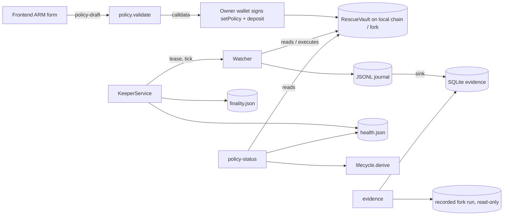

# ARM PROTECTION — backend architecture

ARM PROTECTION turns a validated policy into an on-chain authorization (signed by the position owner), a funded
RescueVault, and a keeper process that watches the position and executes a bounded rescue when the trigger fires.
Every state the product shows is **derived from evidence** (the policy validation, the vault read on-chain, the keeper
heartbeat, the keeper journal and a finality check). No code path sets `ARMED`, `MONITORING` or `VERIFIED` by hand.

Execution happens **only on local test chains** (Anvil, chain id 31337 / 1337, loopback RPC) or local mainnet forks.
FAULTLINE never signs or sends a mainnet transaction.

## Components

| Module (`src/defirisk/countermove/`) | Role |
|---|---|
| `policy.py` | Strict, offline policy validator: the exact `RescueVault.setPolicy` revert rules, plus input hygiene (finite numbers, decimals, strategy names and order, chain allowlist, bounded validity and cooldown). Amounts use `Decimal` (no float rounding). |
| `lifecycle.py` | The state machine: `STATES`, the `ALLOWED` transition table, and `derive()`, which computes the state from evidence and records every gate it checked. |
| `watcher.py` | The existing keeper decision loop (observe → trigger → plan → validate → execute → receipt → verify), journaled to JSONL. Unchanged apart from `signer_from_env`. |
| `service.py` | **Durable keeper service** wrapping the watcher: single-instance lease, heartbeat/health file, RPC backoff, stale-head and head-regression detection, confirmation-depth finality and reorg handling, graceful stop. |
| `journal.py` | Append-only JSONL journal per position (`fsync` on append). An optional sink mirrors every record into the evidence store. |
| `evidence.py` | SQLite (WAL) append-only, hash-chained, idempotent evidence store with environment labels. |
| `status.py` | Read-only API: `evidence`, `keeper-status`, `policy-status`. |
| `api.py` | `policy-draft` (now delegates to `policy.validate`) and the recorded-run payload. |



## Lifecycle state machine

`DRAFT → VALIDATED → AWAITING_AUTHORIZATION → AWAITING_RESERVES → ARMED → MONITORING → TRIGGERED → EVALUATING →
EXECUTING → VERIFIED | FAILED`. `PAUSED`, `REVOKED` and `EXPIRED` can occur from any state. `UNAVAILABLE` means the
evidence needed to say anything is missing.

`derive()` checks the gates in this order; the first one that fails decides the state:

| # | Gate | Fails → state |
|---|---|---|
| 1 | `draft_valid` (when a draft is supplied) | `DRAFT` (if there is no vault read) |
| 2 | `vault_readable` (RPC configured and reachable) | `UNAVAILABLE` |
| 3 | `vault_code` (contract code at the address) | `AWAITING_AUTHORIZATION` |
| 4 | `not_revoked` | `REVOKED` (irreversible) |
| 5 | `policy_signed` (`policy_nonce > 0`) | `AWAITING_AUTHORIZATION` |
| 6 | `policy_matches_draft` (every field except `valid_until`) | `AWAITING_AUTHORIZATION` |
| 7 | `not_paused` | `PAUSED` |
| 8 | `not_expired` (compared with **chain** time, not wall-clock time) | `EXPIRED` |
| 9 | `keeper_authorized` (vault keeper ≠ 0) and keeper = the service's signer | `AWAITING_AUTHORIZATION` |
| 10 | `reserves_sufficient` (reserve ≥ requirement + floor; only when a requirement is supplied) | `AWAITING_RESERVES` |
| 11 | `keeper_heartbeat` (health `ok` **and** this vault is in the service's positions) | `ARMED` — "armed on-chain, but NOT monitored" |

Once every gate passes, the keeper journal refines `MONITORING`:

* An in-flight decision maps `DETECTED` to `TRIGGERED`, `PLANNING`/`VALIDATING` to `EVALUATING`, and `EXECUTING` to `EXECUTING`.
* Otherwise the **last terminal outcome** decides (the watcher logs `WATCHING` every tick after an outcome, so the latest
  record alone is not enough):
  * `CONFIRMED` with finality `final` → `VERIFIED`.
  * `CONFIRMED` with finality `reorged` → `FAILED`.
  * `CONFIRMED` without finality yet → `EXECUTING`.
  * `FAILED` while still in backoff → `FAILED`.
  * `NO_ACTION` → `MONITORING` with `alert: true`.

`ALLOWED` / `can_transition()` documents which moves are legal. `REVOKED` is terminal.

## Keeper service (`python -m defirisk.countermove.service`)

```
python -m defirisk.countermove.service --config <cfg.json> [--journal-dir D] [--state-dir S]
       [--evidence-db PATH|none] [--environment local-test|fork] [--confirmations 2] [--interval 3]
       [--max-ticks N] [--max-head-age SECONDS]
```

The signer comes from `FAULTLINE_KEEPER_KEYSTORE` + `FAULTLINE_KEEPER_PASSWORD_FILE` (an encrypted keystore). The
keystore is only unlocked after `rpc.assert_local()` passes. A plaintext `FAULTLINE_KEEPER_KEY` is refused. Without a
keystore the service runs watch-only.

Each `tick()` runs these steps, in this order:

1. Read the chain head. If that fails: back off (`interval × 2^n`, capped), mark health `degraded` and then
   `unavailable`, and make **no decision**.
2. If the chain id was unknown at start (RPC down), resolve it now. A non-local chain stops the service before the
   watcher runs.
3. Head checks. A head that is older than `--max-head-age` skips decisions. A head that moves backwards or changes hash
   at the same height sets `reorg_suspected` and is recorded as evidence.
4. **Finality before decisions.** Each pending CONFIRMED tx is re-read:
   * Receipt gone → `reorged`: journal `FAILED (event reorged)`; the watcher re-plans from fresh state under a new action id.
   * Receipt in a different block → re-verify; if it no longer verifies → `reorged`.
   * Depth ≥ `confirmations` → `final` (the lifecycle can then show `VERIFIED`).

   Either reorg case also sets `reorg_suspected`.
5. `watcher.tick()`. New CONFIRMED txs are added to the finality tracker.
6. Atomically write `health.json` (temp file + `os.replace`). A heartbeat row is written as evidence (rate-limited).

**Single instance:** `Lease` takes an OS file lock (`msvcrt` on Windows, `fcntl` elsewhere) on `<state-dir>/keeper.lock`.
A second service on the same state directory fails with `LeaseHeld`, which identifies the holder. The OS releases the
lock when the holder dies, so there is no stale-lease cleanup.

**Health** (`faultline.keeper.health/1`) contains:
* `status` (`starting|ok|degraded|unavailable|stopped`), `heartbeat_at`, `chain_id`, the head and its age;
* `consecutive_rpc_errors`, `reorg_suspected`, `confirmations_required`;
* per position: the last event, the last terminal outcome, and finality.

`read_health()` downgrades a heartbeat older than its staleness limit to `stale`; `stopped` is never downgraded.

## Evidence model

* **JSONL journal** (`journal.py`): the primary, crash-safe record (`fsync` on every append).
* **SQLite evidence store** (`evidence.py`, schema `faultline.evidence/1`):
  * `kind` is one of `policy_draft, transition, observation, trigger, decision, rejected_strategy, validation,
    execution_attempt, receipt, verification, finality, failure, heartbeat, error, lifecycle`.
  * Append-only: UPDATE and DELETE triggers abort.
  * Hash chain: `hash = sha256(prev_hash + canonical row)`, and `verify()` re-walks it.
  * Idempotency key is UNIQUE (`receipt:<tx>`, `attempt:<tx>`, `verification:<tx>`, `journal:<…>`), so a tx produces at
    most one receipt row and replaying a journal is a no-op.
  * Every row carries an `environment` (`local-test | fork | mainnet-readonly`). Transaction kinds are **refused** for
    `mainnet-readonly`.
* **Recorded fork run** (`data/countermove/demo/latest/`): served read-only by `?action=evidence`, labelled `fork`,
  with a sha256 of the journal. It is never rewritten.

## What is real and what is simulated

| Item | Status |
|---|---|
| Policy validation, calldata | Real (exact contract rules) |
| Vault reads, lifecycle gates | Real reads of the configured chain |
| Keeper decisions, tx, receipts, verification | Real **on local Anvil / local fork only** (SIMULATED environment, test funds) |
| Price shocks in tests / demo | Simulated (a test oracle on the local chain) |
| Mainnet | Read-only (dry-run, analysis); never transacted |
