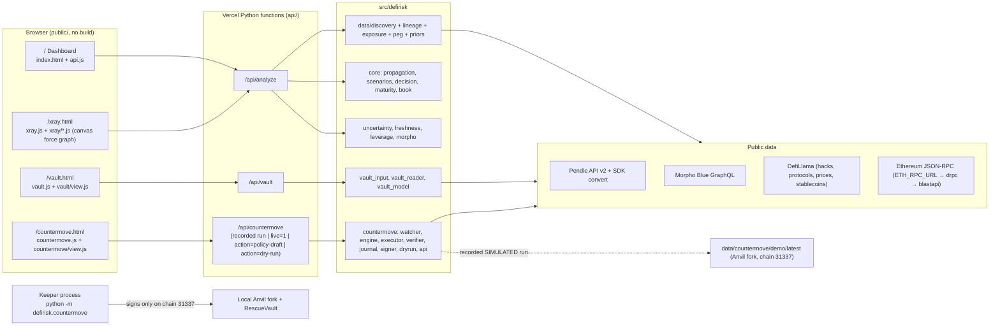

# A. Project Understanding

## A1. Repository and delivery state

| Item | Verified value |
|---|---|
| Root | `C:\Users\badis\Hack\defi-hackathon-2026` (GitHub `Amine097/defi-hackathon-2026`) |
| Branch / tree | `main` @ `834a99b`, clean. `origin/main` @ `5f2a859` = empty deploy-trigger commit (no diff) |
| Other refs | local `fix/xray-belem-review`, `b10taj-*` (all merged into main); remote `work/frontend-redesign` @ `2a77f03` (WIP UI from 10 Oct 18:58–21:17, based on `eb4a133`, i.e. **before** Phase 2 Countermove and the role-aware model) |
| Production | https://faultline-sandy-three.vercel.app — static `public/` + Python functions `api/*.py` (maxDuration 60 s). Verified 11 Oct 02:3x CEST: pages 200, `/api/analyze` 200 in 20.7 s (`source: live`, REVIEW, HOLD_TO_MATURITY block and real book present) |
| Deploy path | `deploy-vercel.sh` (via `deploy-vercel.cmd` → WSL) stashes local changes, pulls, makes an **empty commit as the owner's e-mail** and pushes `main` (Vercel Hobby requires owner-authored commits). An agent must never run it unattended |
| Deadline signal | `PLAN.md`: "deadline Sun 11 Oct 11:00 … demo video by 09:30, submit by 10:30". If still valid, ~8 h remain after this audit (see I) |

## A2. Stack

- **Backend:** Python 3.14 (`.venv`: numpy, networkx, requests, pytest; `web3`/`python-dotenv` listed in
  `requirements-dev.txt` are not installed and not imported). Vercel serverless handlers built on `BaseHTTPRequestHandler`.
  Local runner `scripts/dev_server.py` serves `public/` and routes `/api/*` to the same handlers.
- **Frontend:** static HTML + CSS + vanilla JS (classic scripts and ES modules), **no build step, no npm, no CDN, no
  framework**. Four pages, ~2,500 lines of JS. System font stack; generic dark palette (`--accent #3b82f6`).
- **Contracts:** Foundry 1.8.5 (installed at `%USERPROFILE%\.foundry\bin`, not on PATH). `RescueVault.sol` (332 lines),
  test-only `sim/ShockFeed.sol`, `sim/LocalSim.sol`. Pinned deps: forge-std v1.17.0, OpenZeppelin v5.6.1,
  morpho-blue v1.0.0 (`contracts/install_deps.ps1`, already installed and built locally).
- **Tests (run during this audit):** pytest **252 passed / 17 skipped** (skips = live-network tests behind
  `DEFIRISK_LIVE_TESTS=1`; the Countermove e2e tests ran against a local Anvil); Node view-model tests **33/33**;
  forge **29 passed / 1 skipped** (mainnet-fork test needs `ETH_RPC_URL`). These match the claims in
  `docs/FAULTLINE_BELEM_BRIEF_REVIEW.md` §12. The fork demo (`scripts/countermove_fork_demo.py`) was **not** re-run: it
  overwrites committed evidence in `data/countermove/demo/latest/`.

## A3. Architecture

Every external call goes through `data/http.py`: **live first, disk cache on failure** (`data/cache/`, gitignored;
9,748 files / 122 MB locally). Each payload reports provenance `live | cache | mixed`, `data_as_of`, and per-input
freshness (exit quote TTL 60 s, chain state 120 s, market data 15 min, priors 7 days). Stale, replayed or approximated
decisive inputs force REVIEW.

## A4. Frontend routes (main)

| Route | Purpose | Data | Notes |
|---|---|---|---|
| `/` | "Dashboard": wordmark hero, verdict, KPIs, drivers, 5-layer explainer, scenarios, book, methodology | `/api/analyze` + `location.search`; **falls back silently to `/data/sample.json`** | No landing / brand experience exists on main |
| `/xray.html` | Canvas force/layered dependency graph, click-to-fail, decision card, break-even sliders, book, concentration, look-through | `/api/analyze?ref=`; select for `sample.json` / `sample-large.json`; falls back to `sample.json` | Most sophisticated page; recomputes losses client-side (see C1) |
| `/vault.html` | Morpho vault analyzer form → verdict, allocations, SVG graph, risk, scenarios, custom shock, sensitivity, withdrawal, assumptions, provenance | `/api/vault` | Deep links `?address=&value_usd=&horizon_days=` |
| `/countermove.html` | S1–S5 recorded fork run: story, LTV gauge, before/during/after, checks, live dependency reads, policy draft form | `/api/countermove` (+ `live=1`, `action=policy-draft`) | Honest SIMULATED labelling |

## A5. API contracts (verified by calls)

| Endpoint | Inputs (validated) | Output (schema) | Errors | Measured latency |
|---|---|---|---|---|
| `GET /api/analyze` | `ref` = `auto` \| `pendle:1:<market>` \| `mock`; `value_usd` 1e3–1e8 (default 1e6); `shock=<node id>`, `severity` 0–1; `borrower` = `0x…` \| `auto`; `book_usd` 1e4–1e10; `exit_cost_pct` 0–1; `book_shock=<dependency key>`, `book_severity`; `weights` (≤10, normalised). Horizon fixed at 30 d | `position, nodes[12], edges[19], node_contrib_usd, var95_usd, mc_mean_usd, decision, maturity, exit, scenarios[4], custom_shock, stress_table, sensitivity{rows, lgf_rows, transmission_rows}, assumptions, uncertainty, liquidation, provenance, source, data_as_of, book, incident` | 400 `invalid_input` (e.g. other chains, bad node id); **502 `discovery_failed`** with cause (no silent mock) | 21.6–35.6 s local, 20.7 s prod; `ref=mock` 0.1 s |
| `GET /api/vault` | `address` or allowlisted `url` (morpho.org, etherscan.io, dune.com; never fetched); `chain_id=1` only; `value_usd`; `horizon_days` 1–365; `shock`, `severity` | `faultline.vault/1`: `input, vault, snapshot, allocations, dependencies{nodes,edges}, risk, exit{routes: ordinary, force_deallocate}, decision, scenarios[6], sensitivity, warnings, assumptions, provenance, mode, as_of_block` | 400, 404, 422 `unsupported_contract`, 500 generic (no figures) | 15.4–24.6 s |
| `GET /api/countermove` | — | `faultline.countermove/1`: `environment` (fork block 26,164,248, chain 31337), `positions[5]` (before, shock, timeline, reserve_requirements, crisis, decision, validation, execution, protections), `keeper_runs`, `labels`, `all_expected` | 500 generic | 0.07 s |
| `…?live=1` | — | + `live` (oracle + feeds of protected markets, read now, block) | `status: unavailable` | 9.2 s |
| `…?action=policy-draft` | strategies, trigger_ltv, min_ltv_after, lltv, caps, reserves, decimals, valid_days, cooldown_s | `valid, errors, warnings, policy, calldata (setPolicy)`; never signed | 400 | <0.1 s |
| `…?action=dry-run` | `market` (alias `cbBTC/USDC`, `weETH/USDC`, or 32-byte id), `borrower` (`0x…`/`auto`), `rank`, hypothetical policy/reserves | `faultline.countermove.dryrun/1`: LIVE position + dependencies, DRY-RUN watcher state, engine decision, reserve per first hit, `not_done`; **no transaction field** | 400 / 404 / 503 | 3.9 s |

## A6. Backend modules

- **Dependency discovery** `data/discovery.py`: picks the largest listed Morpho market with a Pendle PT collateral
  (`auto`) or a given Pendle market; builds the five Belem layers plus hidden nodes (issuer, underlying, backing
  stablecoin, oracle → feed provider, Morpho Blue, chain, look-through base assets); reads **every** oracle feed
  on-chain; feed-quality multipliers; concentration and shared exposure across the Morpho PT book; real-book market list.
- **Lineage / exposure / peg** `data/lineage.py`, `exposure.py`, `peg.py`: recursive token unwrapping (ERC-4626
  `asset()`, Pendle API, curated `data/registry.json`, depth ≤ 8, unknown shares kept `UNKNOWN`), look-through %,
  coverage, 90-day peg/basis statistics.
- **Priors** `data/priors.py`: DefiLlama hack base rates (cohort TVL ≥ $10M, ≥ $1M incidents, 3 years) with audit /
  TVL / age modifiers; stablecoin depeg from price history; LGF calibrated on the same 23 exploits
  (`data/calibration/hack_severity.json`: mean 19.2 %, 95 % CI 9.4–31.5 %); chain 0.5 %/y and LGF 30 % remain assumptions.
- **Core** `core/propagation.py` (exact independent-failure expectation + 20k-draw Monte Carlo VaR95, best-path or summed
  transmission), `models.py` (edge **channels**: `principal | debt | exit`; position `exposure_role`), `scenarios.py` (4
  role-keyed scenarios + ad-hoc `shock()`), `decision.py` (executable Pendle exit quote re-executed by `eth_call`, gas,
  decomposition, stressed exit; `decide_robust`), `maturity.py` (EXIT vs HOLD_TO_MATURITY vs STAY), `book.py` (real book).
- **Uncertainty / freshness** `uncertainty.py` (parameter classes, loss and exit bands, carry, robust signal),
  `freshness.py` (TTL per input, blockers).
- **Borrower** `leverage.py` + `morpho.py`: real borrower state at the analysis block, liquidation arithmetic, price
  grid, Monte Carlo expected borrower loss, interest drift, borrower decision, historical liquidation check,
  **Countermove policy suggestion**.
- **Vault analyzer** `vault_input.py`, `vault_reader.py`, `vault_model.py` (1,068 lines): V1/V2 detection by factory,
  one pinned block, per-adapter reconciliation, allocations, look-through graph, bad-debt band, two-direction oracle
  failure, ordinary vs `forceDeallocate` exit simulated by multicall with storage overrides, FX/peg decomposition.
- **Countermove** `countermove/*`: watcher state machine (WATCHING → DETECTED → PLANNING → VALIDATING → EXECUTING →
  CONFIRMED/FAILED/NO_ACTION), deterministic engine (security → feasibility → buffer ≥ margin in every scenario → least
  reserve committed), guarded executor (5 pre-send checks), verifier (12–15 on-chain checks), JSONL journal, keystore
  signer (refuses chain ≠ 31337 and plaintext keys), read-only mainnet dry run.
- **Contract** `RescueVault.sol`: owner sets a nonce-versioned policy (strategies bitmask, trigger LTV, LTV floor,
  per-action and total caps, reserve floors, validity, cooldown); keeper may only `executeRepay/TopUp/FullRepay` for the
  immutable beneficiary/market while on-chain LTV ≥ trigger; owner can pause, revoke, withdraw reserves. Not audited,
  not deployed outside local forks; no deploy script or factory in the repo.

## A7. Measured behaviour (live, 11 Oct 2026 01:55–02:05 CEST, blocks ~26,165,455–26,165,500)

**Position `auto`** = $1M PT-reUSD-10DEC2026 posted as collateral on Morpho (USDC market), 30 d, no debt:
REVIEW (low confidence), lean STAY, STAY holds below ×6.81 risk. Expected loss **$761** [$39–$19,664]; exit execution
**$1,130** (0.11 %, Pendle SDK via KyberSwap, re-executed `eth_call` → `simulated`); carry forgone **$4,049**; exit side
**$5,179** [$3,154–$7,203]. Graph 12 nodes / 19 edges; 7 hidden nodes. Top drivers: USDC depeg history $434,
Ethereum $124, reUSD $71.

| Check | Result |
|---|---|
| Oracle failure / Morpho market / feed / AMM on a no-debt position | **$0 added** ("no effect without debt" / "exit channel only") — role-aware fix works |
| Underlying depeg −30 % | $270,503 conditional → EXIT |
| Liquidity crisis | loss unchanged ($761), exit side ↑ to $6,309 → STAY |
| Hold to maturity (60.0 days) | HOLD $1,515 [$77–$35,623] vs EXIT $9,228 [$5,179–$13,277] → HOLD_TO_MATURITY (low) |
| Incident `shock=issuer&severity=0.5` | $360,451 vs $5,513 → EXIT; book: 2/10 pockets hit, exit both |
| Book, brief's 11 % exit cost | exit the 2 reUSD pockets, book loss 2.52 % |
| Borrower `auto` | 0xAa34…5Dd5: collateral $12.66M, debt $11.06M, LTV 87.35 % vs LLTV 91.5 %, HF 1.047, 4.5 % to liquidation; borrower verdict REVIEW; policy suggestion trigger 87.5 % |
| Vault Belem RWA EURCV (V2), $1M | REVIEW lean STAY (×3.21); loss $657 vs exit side $2,108 (execution $0.09 + carry $2,107); full exit only via `forceDeallocate` (ordinary capacity $411k) |
| Countermove | S1–S5 `all_expected: true`; S5 = Belem's PT example (Ojo PT feed −5 % → repay 1,447.44 USDC, 15/15 checks) |
| Dry run cbBTC/USDC | largest borrower LTV 44.7 % → WATCHING / HOLD, LIVE block, no tx field |

## A8. Limitations that shape the UI

1. Ethereum mainnet only; `/api/analyze` covers Pendle PTs used as Morpho collateral (`auto` or one market), not
   arbitrary wallets or protocols; horizon fixed at 30 days.
2. Live analyses take **15–36 s** (Vercel cap 60 s) and depend on public RPCs and third-party APIs.
3. The book is the 10 largest Morpho PT markets (6 distinct PTs), not Belem's actual portfolio.
4. Countermove execution exists **only** on a local Anvil fork; the hosted site serves a recorded run, live read-only
   dependency reads, a dry run and policy calldata. No RescueVault is deployed anywhere a judge or user could sign for.
5. No wallet connection, no alerts (C5 not done), no exit-runway endpoint, no dedicated Breaking Point / Whale /
   Reaction Window / Chain of Blame / Leverage Hunter engines.
